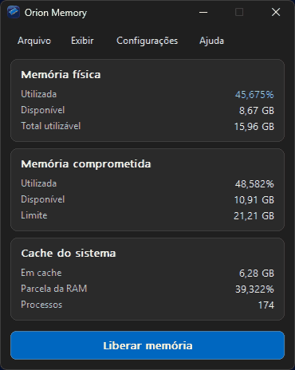

# Orion Memory

**Gerenciador de memória nativo para Windows — v1.0.0**

O Orion Memory monitora o uso de RAM, a memória comprometida e o cache do sistema. Oferece limpeza manual configurável e um indicador dinâmico de uso de memória na área de notificação. Desenvolvido em **C/Win32**, sem exigir .NET para executar.

## Download do Orion Memory

Baixe o **[Orion Memory v1.0.0 — instalador oficial](https://github.com/Projeto-OrionOS/Orion-Memory/releases/tag/v1.0.0)** para Windows x64 na página **Releases**. Não é necessário compilar o programa para instalá-lo.

## Interface

## Compartilhe o Orion Memory

O **Orion Memory é gratuito**. Você pode divulgar o projeto, criar vídeos e tutoriais, compartilhar o link oficial e redistribuir gratuitamente os pacotes oficiais **sem modificá-los**, mantendo os créditos de **Orion Company** e a [licença](LICENSE). Não é permitido vender o aplicativo, cobrar pelo download ou apresentá-lo como se fosse de outra autoria.

## Funcionalidades

- Monitoramento de memória física, memória comprometida e cache.
- Nove operações selecionáveis de liberação de memória.
- Indicador numérico de RAM na bandeja e menu contextual.
- Configurações de aparência, atalhos e notificações.
- Histórico de limpezas e opções de inicialização com o Windows.
- 30 idiomas e detecção do idioma do sistema na primeira execução.
- Aplicativo nativo para Windows x64.

> A liberação de caches e conjuntos de trabalho pode aumentar a atividade de disco ou prejudicar temporariamente o desempenho. O aplicativo não aumenta a memória RAM física.

## Estrutura

| Caminho | Conteúdo |
|---|---|
| `NativeHost/` | Código-fonte C e recursos Win32 |
| `Assets/` | Ícones e imagens |
| `Languages/` | Traduções do aplicativo |
| `Languages.json` | Catálogo de idiomas |
| `Tests/` | Testes e diagnósticos |
| `scripts/` | Script nativo de compilação |
| `.github/workflows/` | Compilação automática Windows x64 |

## Publicação

O **Orion Memory v1.0.0** está disponível na [página oficial de download](https://github.com/Projeto-OrionOS/Orion-Memory/releases/tag/v1.0.0), com o instalador `OrionMemory_Setup_v1.0.0.exe` para Windows x64. Os lançamentos oficiais e seus arquivos ficam na seção **Releases**.

## Segurança

Algumas operações avançadas exigem privilégios do Windows. Verifique a origem dos arquivos e seus hashes SHA-256. Um hash não substitui uma assinatura digital Authenticode.

## Licença e direitos autorais

**© 2026 Orion Company — Todos os direitos reservados.** A [licença proprietária](LICENSE) permite o uso, a divulgação e a redistribuição gratuita de pacotes oficiais não modificados, com créditos e licença preservados. Proíbe a revenda e a falsa atribuição de autoria. O código-fonte não pode ser reutilizado, modificado ou redistribuído em outros projetos sem autorização, ressalvados os direitos previstos em lei e nos termos do GitHub.

Este repositório público não equivale a uma licença de código aberto.
